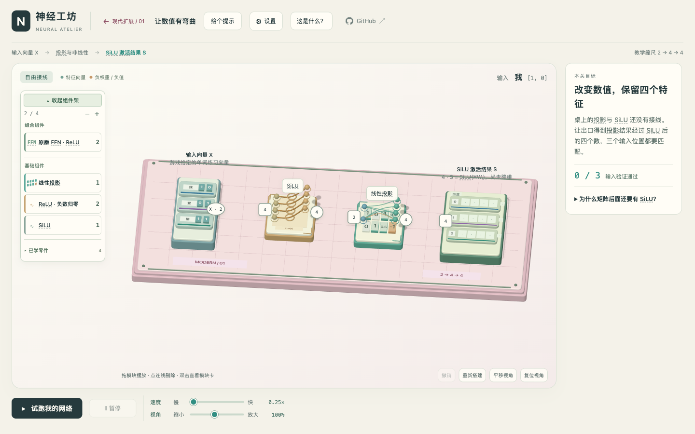
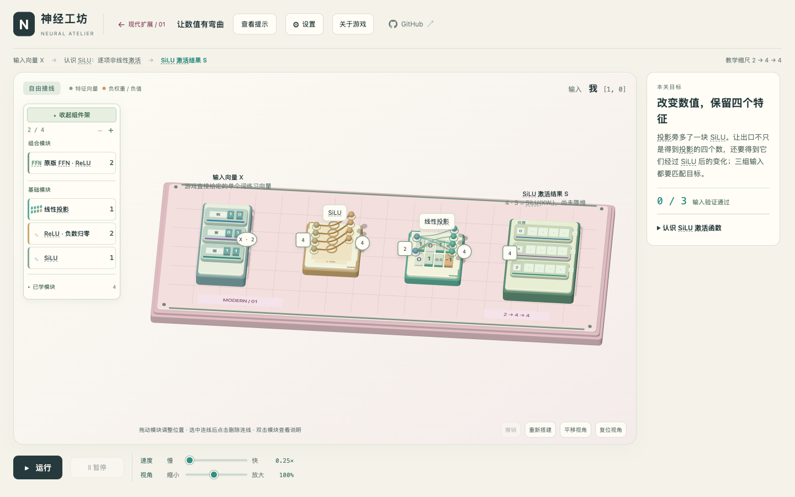

# 全产品文案审校记录

当前版本以“直观上手 → 动手观察 → 对应专业术语”为文案顺序。借鉴 ASD-STE100 的术语一致、动作明确及短句原则，但不把学习产品写成技术操作手册，也不宣称规范认证或全面合规。

改动分两轮：第一轮从 `928ba3d` 审校全产品中英文；第二轮根据学习体验反馈，恢复有用的形象标题，把定义和推导放回现有原理说明与模块卡。下面的课程示例和截图以第二轮最终文案为准，操作、错误、库存和重置的准确表述继续保留。

## 范围与保留项

- 审校全部 58 关：主线 30、现代扩展 13、云端 6、端侧 9。
- 同步检查首页、导航、设置、关于、选关、模块卡、库存、结构图、Canvas 标签、tooltip、ARIA、运行反馈、错误、完成提示和双语 README。
- 不增加折叠层，不缩小字体；本轮不是把原文隐藏起来。清晰且准确的原文保留，数学解释不会为了变短而删除。
- 保留公式、权重、样本、参考解、端口维度、库存、预算、课程顺序、存档及 URL 行为。
- 顶栏控件挤左是已知的独立布局问题，本轮未修改 CSS，也未修该问题。

## 学习分层：内部迭代记录（不是线上 Before/After）

本表的 Before 是第一轮过于技术化的文案，After 是当前最终文案。不是让两套正文并排重复，也不新增学习模式、弹窗或通关解锁层。现有原理和模块卡在学前、学后均可查看。

| 位置 | 第一轮 Before | 当前 After |
| --- | --- | --- |
| SiLU 标题 | 对投影结果应用 SiLU / Apply SiLU to projected features | 让数值有弯曲 / Bend the numbers |
| SiLU 目标 | 输出投影结果经 SiLU 计算后的 4 维向量 / Output the four-dimensional vector after applying SiLU to the projection | 改变数值，保留四个特征 / Change the values, keep four features |
| SiLU 原理入口 | 为什么矩阵后面还要有 SiLU？ / Why follow a matrix with SiLU? | 认识 SiLU 激活函数 / Meet the SiLU activation function |
| 残差标题 | 把 FFN 输出加回输入 / Add the FFN output to the input | 留一条回来的路 / Keep a path back |
| 编码器目标 | 用自注意力和 FFN 更新特征 / Update features with self-attention and an FFN | 先交流，再加工 / Exchange, then process |
| 云端首关标题 | 在 GPU 上计算投影 / Compute a projection on the GPU | 先让一张 GPU 算起来 / Start with one GPU |
| 两卡按列拆分标题 | 按列拆分权重 / Split weights by column | 一块矩阵，两张卡 / One matrix, two GPUs |
| 端侧调度目标 | 结果正确，模拟首词时间 ≤ 110 ms / Correct results; simulated time to first token ≤ 110 ms | 让第一个词早点出现，结果不变 / Get the first token sooner without changing the result |

术语没有删除，只是与具体动作连起来：

- **SiLU 模块卡**：“投影模块送来四个数 P，SiLU 分别处理它们，得到四个数 S。这叫‘逐项激活’……”再解释非线性变换及 `SiLU(x) = x · sigmoid(x)`。原理保留线性矩阵为什么可以合并、加入 SiLU 后为何通常不能合并的推导。
- **残差原理**：“把一段计算的输出加回这段的输入，这叫残差连接：Y = X + FFN(X)。”随后说明修改量可以增加、减少或抵消原值。
- **两卡协作原理**：从“一张卡算一半特征”引入列并行，从“两份贡献相加”引入行并行与部分和；拼接不等于相加。
- **端侧调度原理**：从“把任务交给擅长它的设备，并安排好交接”引入异构调度。具体模拟预算仍在操作说明和预算栏中，不从验收条件移除。

### 第一轮保留的操作改进

以下仍以 `928ba3d` 为 Before，不与上面的学习语气调整混用：

| 位置 | Before | 当前保留 |
| --- | --- | --- |
| 运行按钮 | 试跑我的网络 / Run my network | 运行 / Run |
| 完成后按钮 | 重玩本关 / Replay level | 返回工作台 / Return to workbench |
| 未接线运行 | 「我」未通过。运行报告只显示“数值不匹配”。 | 输入 我 未通过验证。请查看运行报告。报告显示“出口未连接。请连接一个输出端口。” |

“返回工作台”没有新增重置行为：原行为就是保留接线、清除本次结果。新名称使说明与行为一致。

## 全区域覆盖

| 区域 | 本轮处理 | 保留及原因 |
| --- | --- | --- |
| 首页、导航、设置、关于 | 统一动作名；加载失败提示刷新重试；重置说明列清除/保留范围与撤销区别 | 保留品牌、教学缩尺、未训练和模拟非实测边界 |
| 选关 | 同步最终生效的标题、摘要和依赖说明 | 保留路线、顺序和关卡标识，不把编号当成不稳定的课程引用 |
| 模块卡与结构图 | 检查关卡上下文和后置覆盖；统一模块/端口术语；纠正 Q/K/V 输入和可选降维卡说明 | 保留公式、例子、图内计算结构；不把拼接、求和、残差混为一谈 |
| 库存和放置 | 区分本关不提供、全部已放置、台面上限和运行中禁用；失败提示恢复动作 | 库存不足仍可 Enter/双击查看说明，不改变添加条件 |
| 运行与完成 | 统一运行/暂停/继续；错误报告显示具体原因；完整演示不再暗示主线全部完成 | 保留验证、容差、运行及完成判定 |
| 无障碍与动态句 | 完整句模板包含名称、形状、连接状态；运行时不再提示模块可移动 | 保留键盘行为；动态错误安全显示为文本 |
| README | 中英操作名、接线、删除、重置、暂停和库存说明与界面同步 | 不翻修开发历史文档 |

## 58 关清单

下面列出两轮累计的主要改动字段。每关还检查模块卡、输入/输出边界、说明的实际覆盖来源及结构提示。第二轮重点回调标题、目标和概念引入顺序；第一轮准确的边界、操作及错误反馈保留。标题未变不表示未检查，字段有变化也不表示其中每句话都重写。

### 主线（30）

| 关卡 ID | 主要修改或保留说明 |
| --- | --- |
| wire | 标题、操作、摘要、输入说明、原理；保留原样传递的目标 |
| projection | 标题、操作、摘要、输入说明；保留 2 → 4 维目标 |
| relu | 标题、概念、输入说明；保留 ReLU 运算和明确的操作 |
| down-projection | 标题、操作、输入说明；保留矩阵维度 |
| original-ffn | 标题、操作、概念、输入说明；保留 ReLU FFN 结构 |
| workshop | 标题、操作、摘要、原理、组件架说明 |
| residual | 标题、概念、输入、原理和组件架说明；明确加回输入 |
| embedding | 标题、目标、操作、摘要、概念、输入说明 |
| positions | 标题、概念、输入、组件架说明；保留正弦位置编码 |
| layernorm | 标题、目标、操作、摘要、原理和组件架说明 |
| add-norm | 操作、摘要和组件架说明；保留清楚的“先相加，再归一化”标题 |
| qkv | 原理、提示和组件架说明；保留 V 与 Wᵥ 的区别及计算例子 |
| scores | 操作、输出/结果说明、原理；保留分数与比例的区别 |
| softmax | 原理、提示、组件架说明；保留明确的分数转比例目标 |
| pack-scores | 操作、原理、组件架说明；明确仍在计算，不是固定参数 |
| weighted-sum | 操作、摘要、原理、组件架说明；保留 A × V 例子 |
| self-attention | 标题、目标、操作、摘要、概念、原理 |
| multihead | 标题、概念、菜单、组件架说明；保留两个头独立计算 |
| wider-features | 标题、概念、输入、组件架说明 |
| encoder-layer | 标题、目标、概念、输入、原理、菜单及封装说明 |
| causal | 操作、输出/结果说明、原理；保留易懂的“不要偷看未来”，补精确遮罩语义 |
| masked-multihead | 目标、操作、摘要、输出/结果说明、原理及菜单 |
| decoder-self | 标题、目标、操作、摘要、概念、原理及菜单 |
| cross-attention | 标题、操作、摘要、概念、输入、输出和菜单；明确目标 Q、源 K/V |
| decoder-layer | 标题、目标、操作、摘要、概念、输出和菜单；保留三个 Post-LN 子层 |
| vocabulary-scores | 标题、操作、摘要、概念、输入、原理及菜单；不把分数写成概率 |
| encoder-decoder | 标题、操作、摘要、概念、输入和菜单 |
| vocabulary | 操作、摘要、输入/输出/结果及菜单；保留最大分选词规则 |
| autoregressive | 保留已准确的中文任务及上下文更新解释；统一模块说明和英文 token 示例，不以未显示的 hints 作为首屏改善证据 |
| transformer-demo | 目标、操作、摘要、原理和菜单；保留三轮生成、三词窗口、完整重算、无 KV 缓存、未训练等边界 |

### 现代扩展（13）

| 关卡 ID | 主要修改或保留说明 |
| --- | --- |
| activation | 标题、目标、操作、摘要和输入说明，见 SiLU 对比 |
| plain-ffn | 标题、目标、操作、输入说明；明确单支路 |
| gate-projection | 标题、目标、操作、输入说明 |
| pairwise | 标题、操作、输入说明；保留逐项相乘、不求和 |
| gating | 标题、目标、操作、摘要、输入和原理 |
| swiglu | 标题、目标、操作、输入说明；明确降维步骤 |
| normalize | 标题、目标、操作、摘要、概念；区分 RMSNorm 与 LayerNorm |
| ffn | 目标、操作、原理；明确归一化 Z 与原始残差 R |
| rotation | 标题、目标、操作、摘要、概念、原理 |
| rope | 标题、目标、操作、摘要、概念、原理；保留 Q/K 旋转范围 |
| aggregation | 标题、目标、操作、摘要、输出/结果说明 |
| attention | 标题、目标、操作、摘要、输出/结果说明；保留未加残差边界 |
| block | 标题、目标、操作、摘要、概念、原理；区分现代块与原版编码器—解码器 |

### 云端（6）

| 关卡 ID | 主要修改或保留说明 |
| --- | --- |
| single-upload | 标题、目标、操作、摘要、概念和原理 |
| single-fallback | 标题、目标、操作、摘要、概念和原理 |
| single-resident | 目标、操作、摘要、原理；保留每组搬运 16 B 上限 |
| tp-columns | 标题、目标、操作、摘要、输入和原理；明确拼接顺序 |
| tp-rows | 标题、目标、操作、摘要、输入和原理；明确部分和不是残差 |
| tp-ffn | 标题、目标、操作、摘要、输入和原理；保留设备归属与搬运计数 |

### 端侧（9）

| 关卡 ID | 主要修改或保留说明 |
| --- | --- |
| placement | 标题、目标、操作、摘要、概念、结果；明确 CPU/GPU/ANE 分配与模拟首词时间 |
| layout | 同上；补齐已有 ANE 占比要求，保留兼容布局条件 |
| batching | 同上；明确 Prefill 批次与已有 ANE 占比要求 |
| kv-cache | 同上；明确缓存历史 K/V 与追加新位置 |
| quantization | 同上；说明内存包括权重、元数据、KV 和运行空间 |
| fusion | 同上；保留首词及四次解码的负载范围 |
| parallel | 同上；保留首词 ≤ 78 ms、ANE ≥ 20% 的已有预算 |
| session | 同上并改原理；说明前缀复用需要缓存及模型/token/位置匹配，保留误差阈值 |
| capstone | 同上；明确双负载验收，保留全部七项预算 |

## 验证

### 最终 PR 版本：同步上游后

- 已合入 `a032c4c`（上游 PR #3，术语悬浮解释）。保留术语扫描、双语解释、键盘入口及弹窗内显示逻辑；相对该上游版本，`glossary.js` 与 `style.css` 没有改动，不将已有术语能力认领为本 PR 新功能。
- 最终 `npm test`：344 项通过，0 失败、0 跳过，包含术语悬停/聚焦、切语言、重复扫描及弹窗内显示回归。FFN 测试定位到实际介绍术语的原理标题；双语 About 检查明确概念集合，不要求两种语言有相同的词语重复次数。
- 853 项技术数据对比再次通过；该基线是第二轮学习分层开始前的第一轮完成版本，不是最新 `origin/main`。受影响 JS 语法检查、`git diff --check` 通过。
- 最终本地 SiLU 首屏已刷新样式缓存、重拍并目视检查，术语下划线保留。补充实机检查确认中文 SiLU 术语悬停可打开解释、Escape 可关闭；随后键盘聚焦检查未达到预期，继续诊断时被 Orca 输入法保护阻止，未绕过。合并后的键盘及后续卡片/错误实机补验未完成，不能用自动化通过替代这项证据。下节的完整交互检查是在同步上游前完成的。

### 学习分层版本：同步上游前

- 相对第二轮起点（第一轮完成版本）的 853 项技术数据对比通过，覆盖 58 关的初始电路、解法、库存、样本、参考输出、执行输出、路线、权重、维度、预算及端侧成本指标；未发现变化。
- 58 关两种语言的最终标题、目标、说明、摘要、概念、原理，以及当前/可选模块卡检查通过，无缺失翻译或英文中的中文残留。英文词表 1,128 个键无重复。
- 真实浏览器完成 SiLU 接线、运行、三组输入通过、返回工作台、重新查看原理：保存电路不变，运行报告清空，术语说明与通关前一致。Enter 可打开 SiLU 卡片，Escape 可关闭。
- 真实浏览器检查中文 1440px、英文 1080px 的 SiLU、残差、编码器、单 GPU、两卡列并行、端侧调度及完整演示；未出现页面横向溢出。SiLU 首屏、原理和卡片截图已目视检查。
- 新增中英“直观目标＋专业说明、通关前后均可回看”的 UI 回归；卡片断言覆盖逐项激活、非线性变换和 SiLU 公式。Softmax 和 Q/K 公式的断言随说明位置迁移，仍保留数值与技术边界校验。
- 整合后 `npm test`：340 项通过，0 失败、0 跳过，包含新的学习分层 UI 回归和卡片断言。受影响 JS 语法检查、`git diff --check` 通过。

### 第一轮验证记录（历史）

- `npm test`：339 项通过，0 失败、0 跳过。保留原测试和 CI；新增产品动作、错误安全显示、库存可访问性与场景 ARIA 回归。
- 1,141 项基线对比通过：初始状态、样本数值、参考解、库存、预算、权重、路线顺序、输出及运行轨迹无变化。
- 课程、卡片、私有结构翻译检查覆盖 1,031 个关卡×模块组合；两种语言各遍历 20,532 项字符串（包含重复上下文，不是独立文案条数）。未发现缺译、中文泄漏或未展开占位符；已审阅现有同义/大小写覆盖。
- 全量测试运行期间末次调整了两条英文维度错误模板，避免 `1 dimensions` 和 `a 1-dimensional`。参数 1/2/4 的六种完整句检查通过，并补跑相关错误及 ARIA 定向测试；算法未改。
- 真实浏览器：中英首页、设置、选关、SiLU、主线组合、云端、端侧、完整演示；1440px，以及 SiLU/编码器/云端/端侧/演示的 1080px 英文页面均无页面横向溢出。
- 实际触发：未连接出口、未连接模块输入、维度错误、库存用完、台面上限、运行中禁用、Enter 打开模块卡、Escape 关闭、暂停中切语言和继续、完成后返回工作台、两种重置确认后取消。没有为检查文案执行全局重置。
- 浏览器完成返回验证：接线和保存电路保持一致，运行结果清空；暂停切语言保持当前关卡、接线和暂停状态。
- JS 语法检查、`git diff --check` 通过。

## 截图与本地预览

### PR 对比：当前线上 Before / 本地 After

Before 直接截自 <https://hacking.pub/games/neural-atelier/#activation>，不是第一轮未发布的技术化草稿。After 是同步 `a032c4c` 后的最终本地页面，保留上游已有的术语下划线样式。两张图均为中文、1440 × 900、相同视角与模块位置、未接线状态，原理均收起。本地使用独立预览存档，不清除原有电路。

| 当前线上 Before | 本地 After |
| --- | --- |
|  |  |

线上本来就使用“让数值有弯曲”和“改变数值，保留四个特征”，本轮保留这两项，不将其记为相对线上的改进。首屏实际差异是任务说明、术语提示及原理入口、操作名称和接线说明；布局没有重做，任务说明也没有明显缩短。更深入的学习分层体现在原理与模块卡中。

### 学习分层内部迭代（不是线上对比）

这里的 Before 是第一轮专业化文案，不是 `928ba3d`。中文首屏前后保持相同模块位置、无接线状态和 1440px 视口；原理和卡片截图展示已有入口，不是新增界面。英文另以 1080px 检查长文案。

| 示例 | 截图 |
| --- | --- |
| SiLU 中文 Before | [第一轮专业化首屏](images/learning-copy/silu-zh-before.png) |
| SiLU 中文 After | [当前直观首屏](images/learning-copy/silu-zh-after.png) |
| 展开已有原理 | [认识 SiLU 激活函数](images/learning-copy/silu-zh-explanation.png) |
| 打开已有模块卡 | [操作、术语、公式与数值例子](images/learning-copy/silu-zh-card.png) |
| 英文 1080px | [Bend the numbers](images/learning-copy/silu-en-1080-after.png) |

### 第一轮截图归档（不是当前课程文案）

下列旧图的 Before 为 `928ba3d`，After 为第一轮结果。SiLU 文案已经由上面的学习分层版本替代；保留这些图是为了区分两轮，不将旧技术化首屏当成最终成果。错误前后均为零接线并等待运行结束。截图中的既有通关/恢复入口来自本地预览存档，不是新增功能。

| 对比 | Before | 第一轮 After |
| --- | --- | --- |
| SiLU 中文首屏 | [Before](images/product-copy-clarity/silu-zh-before.png) | [第一轮](images/product-copy-clarity/silu-zh-after.png) |
| SiLU 英文首屏 | [Before](images/product-copy-clarity/silu-en-before.png) | [第一轮](images/product-copy-clarity/silu-en-after.png) |
| 未接线错误 | [Before](images/product-copy-clarity/error-zh-before.png) | [After](images/product-copy-clarity/error-zh-after.png) |
| 英文 1080px | — | [第一轮](images/product-copy-clarity/silu-en-1080-after.png) |

本地预览：<http://127.0.0.1:5186/#activation>。文案维护规则见 [copy-guidelines.md](copy-guidelines.md)。本轮通过 PR 提交，不直接部署线上站点。
